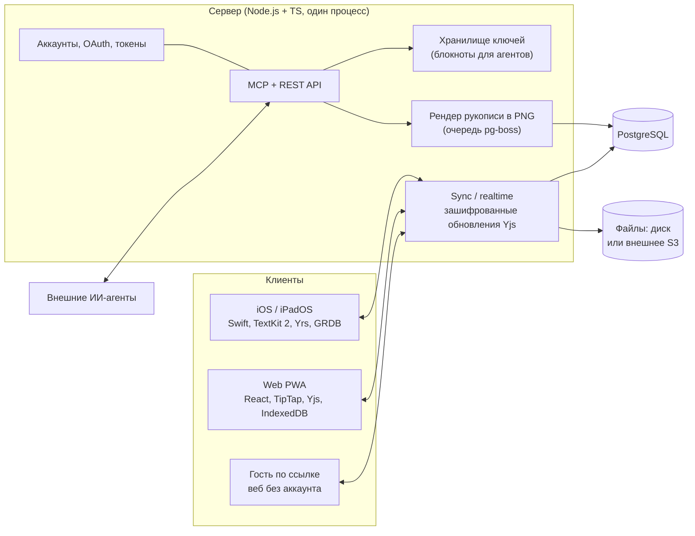

# Обзор архитектуры

## Общая схема



## Ключевые архитектурные идеи

1. **Офлайн-первый.** Каждый клиент держит полную локальную копию своих заметок. Сервер — для обмена, а не для работы.
2. **CRDT вместо серверного слияния.** Каждая заметка — документ Yjs. Сливают правки сами клиенты, поэтому сервер может не видеть содержимое (D-31).
3. **Два режима блокнотов.** Приватные — сквозное шифрование, сервер видит только шифр. Для агентов — ключ на сервере, расшифровка по токену (D-04, D-09). См. `spec/07-encryption.md`.
4. **Живой штрих.** Точки рукописи привязаны к символам текста через относительные позиции CRDT и пересчитываются при перекладке (D-05). См. `spec/03-pencil.md`.
5. **Минимум сервисов.** Сервер + PostgreSQL; файлы — на диске или во внешнем S3 (D-25, D-26). Поднимается одной командой.
6. **Без общего ядра.** iOS (Swift) и веб/сервер (TypeScript) реализуют одни контракты; совместимость проверяется общими тестовыми векторами (D-22).
7. **Тонкие прослойки на местах будущих замен.** Рассылка правок, хранение файлов и слой MCP спрятаны за интерфейсами — их реализацию можно сменить, не трогая остальной код.

## Потоки данных

### Правка в приватном блокноте

1. Пользователь правит заметку на iPad → Yrs создаёт бинарное обновление.
2. Обновление сохраняется в локальной SQLite (правка не теряется даже без сети).
3. Клиент шифрует обновление ключом блокнота и отправляет на сервер по WebSocket.
4. Сервер сохраняет шифр в PostgreSQL и пересылает другим подключённым устройствам.
5. iPhone расшифровывает и применяет обновление к своей копии.

### Правка агента в блокноте «для агентов»

1. Агент вызывает MCP-инструмент `edit_note` с токеном.
2. Сервер проверяет токен и права (в коде и на уровне БД — Row-Level Security), пишет запись в журнал.
3. Сервер достаёт ключ блокнота из хранилища ключей, расшифровывает документ, применяет правку как обычное обновление Yjs, шифрует и рассылает клиентам.
4. Клиенты подсвечивают правку агента; откат — через историю версий (D-10).

## Структура репозитория

```
/
├── CLAUDE.md                 # правила для любого ИИ
├── README.md
├── apps/
│   ├── ios/                  # Xcode-проект (iPhone + iPad)
│   ├── web/                  # Vite + React PWA
│   └── server/               # Node.js + TS: sync, API, MCP
├── packages/
│   ├── shared/               # общие TS-типы и схемы
│   └── test-vectors/         # общие тестовые векторы crypto/sync для Swift и TS
├── infra/                    # docker compose для self-hosting
├── docs/                     # источник истины (см. docs/README.md)
├── graphify-out/             # граф знаний Graphify
└── .claude/                  # навык Graphify, хуки Claude Code
```
