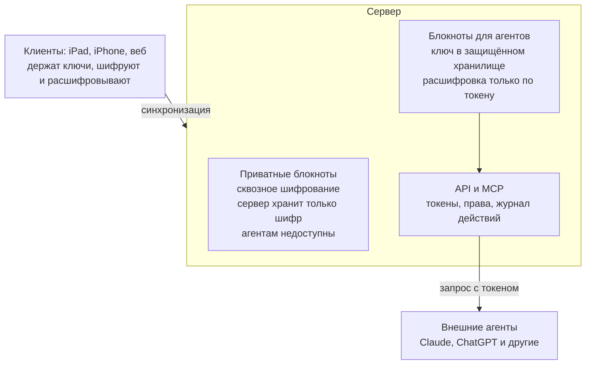
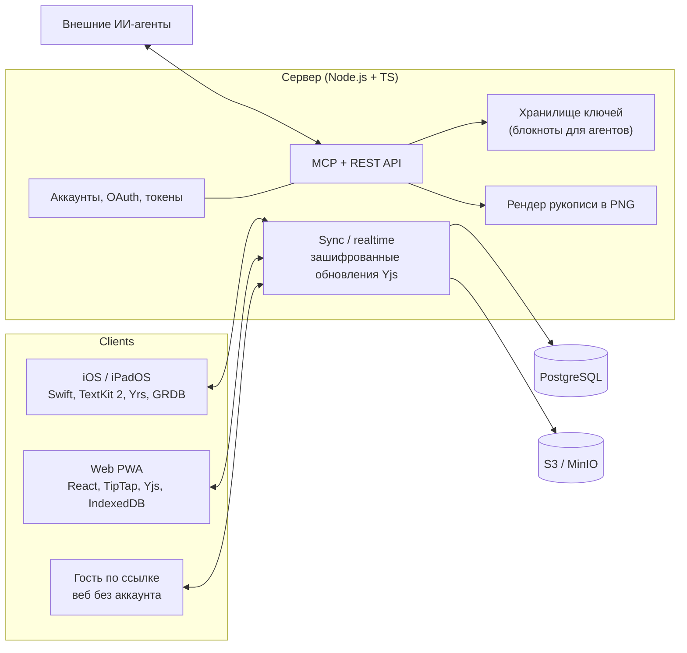

# Datascratch — пакет передачи проекта в Claude Code

> Рабочее название: **Datascratch** (финальное не выбрано).
> Документ собран 25.10.2026 по итогам обсуждения в claude.ai. Это **полный и актуальный** контекст проекта: история, все решения, техническое задание, предложенный стек и план старта.
> Предыдущий черновик ТЗ (Claude Doc): https://claude.ai/artifact/GvGQeFwfATCkrowkck2ADd — **устарел**, этот файл главнее.

---

## 0. Инструкция для Claude Code — прочитай первым

**Кто есть кто.** Пользователь — автор и владелец продукта. Код целиком пишет Claude. Пользователь не программист-исполнитель: решения объясняй простым языком, предлагай варианты с рекомендацией, не заваливай техническими деталями без нужды.

**Язык.** С пользователем общаемся по-русски. Код, идентификаторы, коммиты, комментарии в коде — по-английски. Документация в `docs/` — по-русски.

**Статусы в этом документе:**
- **РЕШЕНО** — подтверждено пользователем, не пересматривать без его согласия;
- **ПРЕДЛОЖЕНО** — рекомендация Claude, пользователь ещё не подтвердил;
- **ОТКРЫТО** — нужно обсудить.

**Первые действия (по порядку):**
1. Обсуди с пользователем открытые вопросы из раздела 10 — прежде всего подтверждение стека и наличие Mac.
2. После подтверждения создай монорепозиторий и разложи этот файл в `docs/` по структуре из раздела 8. Сам этот файл сохрани как `docs/history/2026-10-25-handoff.md`.
3. Создай `CLAUDE.md` по шаблону из раздела 9.
4. Установи Graphify в проект и git-хук пересборки графа (раздел 8.3).
5. Начни этап 1 — прототип пера в тексте на iPad (раздел 7.1).

**Неприкосновенные правила проекта:**
- Документация — единственный источник истины. **Любое** изменение требований, архитектуры или решения в том же коммите отражается в `docs/`: обновлённый раздел ТЗ + запись решения (ADR) + строка в `CHANGELOG`. Цель пользователя: в любой момент передать репозиторий другому ИИ без потери контекста.
- Дизайн — главный принцип продукта (решение D-15). Интерфейс должен ощущаться премиальным, уровня топового SaaS, а не «программы от энтузиаста». Компромиссы по красоте и плавности не принимаются молча — только через обсуждение с пользователем.
- Перо в тексте — ключевая фича и главный технический риск. Его качество важнее широты функций.

---

## 1. Суть продукта в одном абзаце

Приложение для заметок, где **рукописный ввод Apple Pencil и обычный текст живут в одном слое**: пером можно подчеркнуть, зачеркнуть, обвести или заштриховать любое слово прямо в тексте и рисовать прямо на картинках, и пометки едут вместе с текстом при любой перекладке. Это гибрид **Obsidian** (связи, бэклинки, теги, экспорт в Markdown) и **Notesnook** (сквозное шифрование, быстрая надёжная синхронизация), плюс **доступ для внешних ИИ-агентов** через API и MCP: агент извне читает заметки, ищет, вносит правки. Клиенты: нативные iPhone и iPad (главные, App Store) и полноценный веб вместо десктопа. Свой сервер.

---

## 2. История обсуждения (хронология)

1. **Название.** Пользователь предложил «Datascratch» для приложения заметок типа Obsidian с подключением к ИИ. Конфликтующих продуктов поиск не нашёл. Оценка Claude: «scratch» (черновик) удачно, но «Data» уводит в аналитику, «Scratch» ассоциируется со Scratch от MIT. Сгенерированы альтернативы: Mycelia, Weft, Loomnote, Nodal, Synapsa, Cortexa, Thinkwell, Mnemo, Kora, Corvid, Quillmind. Выбор не сделан.

2. **Концепция от пользователя** (суть его слов):
   - нужны клиенты iPhone и iPad — «абсолютно главные», в App Store, полностью функциональные и красивые;
   - Obsidian не устраивает: всё лежит в файлах, слишком нагружено для нормальной синхронизации Apple;
   - хочет **писать Apple Pencil прямо в тексте и прямо в картинках**, взаимодействовать пером с обычным текстом — заштриховать, подчеркнуть. В существующих приложениях текст и рукопись лежат на разных уровнях и не соприкасаются; нельзя подчеркнуть что-то в обычном тексте (не считая маркера);
   - скрестить Notesnook с Obsidian; ИИ **не обязательно внутри** приложения (возможно в будущем), главное — чтобы **внешний агент** мог обращаться извне, читать документацию и заметки, вносить правки.

3. **Первые уточнения:** механику пера — обсудить позже; будет свой сервер («храни как надо»); десктоп-версии нет, на десктопе веб; платформы — натив iPhone + iPad (Pencil) и **неурезанный веб** (сказанное «тв» означало веб, не Apple TV); нужно **и шифрование, и доступ по API**.

4. **Создан черновик ТЗ** в Claude Doc (11 разделов + схема архитектуры ключей).

5. **17 уточняющих вопросов → ответы пользователя** (вошли в решения D-05…D-24 ниже). Пользователь также потребовал: вести документацию как постоянно актуальный источник истины, использовать Graphify, обеспечить передачу проекта другому ИИ без потерь.

6. **Claude предложил технологический стек** (раздел 5) — ждёт подтверждения.

7. **Пользователь попросил собрать этот документ** для продолжения работы в Claude Code.

---

## 3. Журнал решений

| ID | Тема | Решение | Статус |
| --- | --- | --- | --- |
| D-01 | Хранение | Свой сервер, заметки в базе данных, не файлы. Markdown — только экспорт и формат для агентов | РЕШЕНО |
| D-02 | Десктоп | Отдельной десктоп-версии нет, на компьютере — веб | РЕШЕНО |
| D-03 | Платформы | Нативные iPhone и iPad (главные, App Store) + полноценный веб без урезаний | РЕШЕНО |
| D-04 | Безопасность | Одновременно сквозное шифрование и доступ по API: два режима блокнотов (раздел 4.6) | РЕШЕНО |
| D-05 | Перо при перекладке | Вариант **А — «живой штрих»**: форма линии хранится относительно слов, перерисовывается при перекладке, разрезается по строкам | РЕШЕНО |
| D-06 | Рисование пальцем на iPhone | Да, опционально (переключатель в настройках) | РЕШЕНО |
| D-07 | Распознавание рукописи в текст | Не делаем (системный Scribble в полях ввода работает сам) | РЕШЕНО |
| D-08 | Аннотации PDF пером | Делать, но не в MVP — на этапе расширений. На iPad: PDFKit + слой штрихов | ПРЕДЛОЖЕНО |
| D-09 | Режим нового блокнота | Пользователь выбирает режим (приватный / для агентов) при создании блокнота; сменить можно позже с перешифровкой | РЕШЕНО |
| D-10 | Правки агента | Применяются сразу, откат через историю версий. Правки агента подсвечиваются | РЕШЕНО |
| D-11 | Рукопись для агента | Рукописные фрагменты рендерятся в картинки, чтобы агент «видел» их. Формат — **PNG** (модели со зрением читают PNG хорошо, SVG из тысяч координат — плохо); SVG — опционально для экспорта | Идея — РЕШЕНО, PNG — ПРЕДЛОЖЕНО |
| D-12 | Аудитория | В первую очередь для себя, позже, возможно, узкий круг. Не массовый продукт на старте | РЕШЕНО |
| D-13 | Совместная работа | Да: шеринг по ссылке с правкой **даже без аккаунта**, редактирование в браузере на iPhone и iPad; если установлено приложение — ссылка открывается в нём. Совместная правка в реальном времени | РЕШЕНО |
| D-14 | Организация | Богатая, но не перегруженная: проекты, личное, работа, учёба не смешиваются; папки и вложенные папки, умные теги, цвета. Минимум кнопок на экране | РЕШЕНО |
| D-15 | Дизайн | **Основная концепция:** максимально красивый интерфейс, ощущение премиального SaaS-продукта, не «программа энтузиаста» | РЕШЕНО |
| D-16 | Импорт | Не нужен сейчас (Obsidian/Notesnook — возможно позже) | РЕШЕНО |
| D-17 | Языки | Русский и английский. RTL (иврит) не нужен | РЕШЕНО |
| D-18 | Монетизация | Не решено. Варианты: подписка, разовая покупка или open source с self-hosting + платный хостинг «для ленивых». Архитектура с первого дня поднимается одной командой Docker | ОТКРЫТО (self-hosting-готовность — ПРЕДЛОЖЕНО) |
| D-19 | Разработка | Весь код пишет Claude | РЕШЕНО |
| D-20 | Сроки | Начинаем сейчас, без жёсткого дедлайна | РЕШЕНО |
| D-21 | Стек | См. раздел 5 | ПРЕДЛОЖЕНО |
| D-22 | Общее ядро на Rust | Убрать из плана (было в черновике ТЗ). Вместо него — экосистема Yjs/Yrs, libsodium на обеих сторонах и общие тестовые векторы | ПРЕДЛОЖЕНО |
| D-23 | Документация | Источник истины — `docs/` в репозитории + граф знаний Graphify, обновляемый на каждом коммите | РЕШЕНО (требование пользователя), структура — ПРЕДЛОЖЕНО |
| D-24 | Название | Datascratch — рабочее. Оценка Claude: для «премиум»-концепции звучит слишком технично и длинно; финальное выбрать до App Store. Кандидаты: Kora, Margins, Folio (проверить занятость) | ОТКРЫТО |

---

## 4. Техническое задание (актуальная версия)

### 4.1. Платформы

| Клиент | Роль | Ключевое |
| --- | --- | --- |
| iPad | Главный, работа с пером | Apple Pencil, Pencil Pro (сжатие, вращение), hover, Stage Manager, клавиатура и шорткаты |
| iPhone | Главный, быстрые заметки | Тот же код, что iPad; удобство одной рукой; рисование пальцем — опция |
| Веб | Полноценная замена десктопа | Все функции, включая рукопись мышью и стилусом (Pointer Events с нажимом, Safari на iPad отдаёт нажим пера), офлайн, установка как PWA, удобная правка в мобильном браузере (для гостей по ссылке) |

- На iOS редактор **только нативный**, не WebView — иначе заметна задержка пера.
- Минимальная версия iOS/iPadOS — ОТКРЫТО (предложение: текущая и предыдущая мажорная версии).

### 4.2. Apple Pencil в тексте — ключевая фича

**Виды рукописного ввода:**
1. **Пометки на тексте** — подчеркнуть, зачеркнуть, обвести, заштриховать, выделить маркером, стрелка от слова к слову. Привязка к диапазону символов.
2. **Заметки на полях** — рукописный комментарий сбоку, привязан к абзацу.
3. **Блок рисования** между абзацами, растёт по высоте.
4. **Рисование на картинках** — штрихи в координатах картинки, масштабируются вместе с ней.
5. **Системный Scribble** — рукописный ввод в текстовые поля (средствами iOS). Распознавание уже нарисованного — **не делаем** (D-07).

**Жесты пером:** зигзаг по слову — удалить; линия под словом — подчеркнуть; линия через слово — зачеркнуть; лассо — выделить текст и штрихи вместе.

**Перекладка текста — вариант А «живой штрих» (D-05).** Штрих привязан к словам, а не к экрану. Когда текст переносится иначе (другая ширина, поворот, iPhone vs iPad, правка текста), штрих перерисовывается и при переносе фразы на две строки **разрезается на части по строкам**.

Гипотеза реализации для прототипа (проверить на этапе 1):
- каждую точку штриха храним не в экранных координатах, а как *(якорь на символ, смещение dx/dy относительно глифа этого символа в единицах размера шрифта)*;
- при перекладке пересчитываем позиции точек от новых позиций глифов;
- если соседние точки попали на символы разных строк — штрих в этом месте разрывается;
- якоря на символы — относительные позиции CRDT, поэтому переживают правки текста, в том числе правки агента;
- отдельно решить на прототипе поведение обводок вокруг нескольких слов и стрелок между словами на разных строках.

**Ощущение пера:** задержка на уровне системного PencilKit, предсказание касаний (predicted touches), нажим, наклон, ластик по штриху и по пикселю, отмена и повтор, 120 кадров/с на ProMotion.

**Технически:** свой слой рендеринга штрихов поверх TextKit 2 (PKCanvasView не умеет привязку к тексту).

### 4.3. Редактор

Блочный, с Markdown-сокращениями, хранение — своя структура.

- Заголовки, списки, чек-листы, цитаты, выноски, таблицы, код с подсветкой, формулы.
- Картинки, PDF и другие файлы во вложениях; блоки рисования.
- Ссылки `[[ ]]` с автодополнением, бэклинки, теги; граф связей — не в MVP.
- Шаблоны и ежедневные заметки.
- Поиск: мгновенный полнотекстовый, **индекс локально на каждом клиенте** (сервер не может искать в зашифрованном).
- Экспорт в Markdown, PDF, HTML; рукопись при экспорте — картинками. Импорт — не сейчас (D-16).

### 4.4. Организация и дизайн (D-14, D-15)

**Структура (ПРЕДЛОЖЕНО):**
- **Пространства** верхнего уровня (например, Личное, Работа, Учёба) — полностью разделяют контексты;
- внутри — **папки с вложенностью** без ограничения глубины;
- поперёк всего — **вложенные теги**, **умные теги** (сохранённые фильтры: «всё с тегом X за неделю»), **цвета и иконки** для папок и тегов;
- избранное и недавние.

**Принципы премиального интерфейса:**
- минимум кнопок на экране: действия — в палитре команд (⌘K на iPad и в вебе), контекстных меню и жестах;
- собственная дизайн-система: типографика, сетка, цвета, иконки, анимации, тактильная отдача (haptics) — единые на iOS и в вебе;
- плавные анимации переходов, продуманные пустые состояния и онбординг;
- светлая и тёмная тема, Dynamic Type, VoiceOver, полная поддержка клавиатуры на iPad;
- ориентиры по ощущению: Things 3, Linear, Craft, Arc.

### 4.5. Модель данных и сервер

- **Текст** — дерево блоков в CRDT (**Yjs**): правки с разных устройств, от гостей и от агента сливаются без конфликтов.
- **Слой рукописи** — векторные штрихи (точки, нажим, наклон, время, инструмент, цвет, толщина) с якорями. Типы якорей: диапазон текста, абзац (поля), блок рисования, картинка.
- **Вложения** — отдельные зашифрованные файлы, загрузка по требованию, докачка.
- **Метаданные** — заголовок, теги, ссылки, даты, пространство, папка.
- **Сервер** — аккаунты, хранение и ретрансляция зашифрованных изменений, вложения, реальное время, API и MCP. PostgreSQL + S3-совместимое хранилище.

### 4.6. Шифрование и доступ агентов (D-04, D-09)

Два режима блокнотов, выбор при создании:

- **Приватные** — как в Notesnook: ключ выводится из пароля пользователя и живёт только на его устройствах. Сервер хранит только шифр и ретранслирует зашифрованные изменения. Агентам недоступны.
- **Для агентов** — ключ блокнота хранится в защищённом хранилище ключей на сервере; расшифровка только по запросу с действительным токеном и правами на этот блокнот.

Смена режима — в любой момент, клиент перешифровывает данные. В интерфейсе честно предупреждаем, что во втором режиме сервер технически может прочитать заметки.

Предложение по криптографии: libsodium на всех платформах; Argon2id для вывода ключа из пароля; XChaCha20-Poly1305 для содержимого; отдельный ключ на блокнот, обёрнутый мастер-ключом пользователя (или ключом сервера для режима «для агентов»).

На будущее: локальный MCP-мост — утилита на компьютере пользователя, которая держит ключ и даёт локальным агентам доступ даже к приватным блокнотам.



### 4.7. Совместная работа и шеринг (D-13)

- Ссылка на заметку или блокнот с правами: просмотр или правка; срок действия; отзыв в любой момент.
- **Без аккаунта**: гость открывает ссылку в любом браузере (включая iPhone и iPad) и сразу редактирует.
- Шифрование не ломается: **ключ лежит в части ссылки после `#`** — браузер не отправляет её на сервер (так делает Excalidraw).
- Совместная правка в реальном времени, курсоры и присутствие; гости отображаются как «Гость».
- **Universal Links**: если приложение установлено — ссылка открывается в нём, иначе в вебе.

### 4.8. API и внешние ИИ-агенты

Подключение через **удалённый MCP-сервер** (Streamable HTTP, вход по OAuth 2.1) и **REST API**. Встроенного ИИ нет, архитектура его не исключает.

**Агент умеет:**
- искать и читать заметки — в Markdown; на месте рукописных фрагментов — **PNG-картинка** этого фрагмента и текстовая пометка, к чему он привязан («подчёркнуто от руки: …») (D-11). Рендер делает сервер, поэтому только в блокнотах «для агентов»;
- создавать заметки и править точечно — по блоку или фрагменту, не перезаписью целиком;
- оставлять комментарии к фрагментам;
- читать ссылки, теги, бэклинки, структуру пространств и папок.

**Безопасность:** токены и OAuth; права на токен — чтение или чтение+запись, по конкретным блокнотам; журнал всех действий; лимиты запросов.

**Правки агента** применяются сразу, подсвечиваются, откатываются через историю версий (D-10); рукописные якоря не ломаются.

Набросок инструментов MCP (ПРЕДЛОЖЕНО): `list_spaces`, `list_notebooks`, `search_notes`, `read_note`, `get_handwriting_image`, `create_note`, `edit_note` (операции над блоками), `add_comment`, `get_backlinks`.

### 4.9. Синхронизация и офлайн

- Офлайн-первый подход: все заметки локально (iOS — SQLite, веб — IndexedDB), сервер — для обмена.
- Реальное время при открытой заметке на двух устройствах.
- История версий: снимки, просмотр, откат.
- Вложения частями, с докачкой; на iPhone можно хранить только миниатюры.
- Корзина 30 дней.

### 4.10. Нефункциональные требования

| Параметр | Цель |
| --- | --- |
| Задержка пера | Не хуже системного PencilKit |
| Прокрутка и рисование | 120 кадров/с на ProMotion |
| Открытие заметки на 10 000 слов | До 300 мс |
| Размер базы | 10 000+ заметок без замедления |
| Первая синхронизация 10 000 заметок без вложений | До минуты |
| Доставка правки на другое устройство | До 2 с |
| Холодный старт | До 1 с |

**Надёжность:** ни одна правка не теряется при обрыве сети, вылете или нехватке места; ежедневные резервные копии на сервере.

**Языки:** русский и английский, RTL не нужен.

---

## 5. Технологический стек — ПРЕДЛОЖЕНО, ждёт подтверждения

Главный принцип: раз весь код пишет Claude — как можно меньше языков и только проверенные библиотеки.

**iPhone/iPad**
- Swift 6; SwiftUI для оболочки (навигация, списки, настройки, сайдбар);
- редактор на UIKit + **TextKit 2**; слой пера — свой рендер (Metal или Core Animation — выбрать на прототипе);
- локальная база — SQLite через **GRDB**;
- CRDT — **Yrs** (Rust-версия Yjs со Swift-обёрткой; бинарный формат совместим с Yjs в вебе);
- криптография — **libsodium** (swift-sodium).

**Веб**
- **Vite + React + TypeScript**, PWA. **Не Next.js / Nuxt**: их сила — серверный рендеринг и SEO, а у нас сервер содержимого не видит (шифрование) и приложение офлайн-первое, SSR только усложнит;
- редактор **TipTap (ProseMirror) + Yjs**; слой пера на Canvas (Pointer Events с нажимом);
- офлайн-хранилище — IndexedDB (Dexie);
- UI — собственная дизайн-система на Radix + Tailwind + Motion;
- лендинг (позже, отдельно) — Astro.

**Сервер**
- **TypeScript на Node.js** (фреймворк — Fastify, ПРЕДЛОЖЕНО). Почему не Go/Rust: синхронизация на Yjs, чья родная среда — JavaScript; общие типы и схемы с вебом; официальный MCP SDK на TypeScript. Для личного использования и узкого круга производительности хватит с запасом. Python, Java, Haskell — без причины не нужны;
- PostgreSQL (ORM — Drizzle, ПРЕДЛОЖЕНО), S3-совместимое хранилище (self-host — MinIO), Redis для реального времени;
- сервис синхронизации: для приватных блокнотов — ретрансляция и хранение зашифрованных обновлений Yjs (сервер не мержит); для блокнотов «для агентов» — сервер может расшифровать и применить правку агента;
- MCP — официальный TypeScript SDK; OAuth 2.1.

**Инфраструктура**
- монорепозиторий: pnpm + Turborepo для TS-частей, iOS-проект рядом;
- CI — GitHub Actions (сборка iOS на macOS-раннерах или Xcode Cloud);
- запуск всего сервера одной командой: `docker compose up` (сервер, Postgres, MinIO, Redis) — это сразу даёт self-hosting (D-18);
- хостинг — VPS (Hetzner или аналог), ОТКРЫТО.

**Совместимость iOS ↔ веб** без общего ядра (D-22): одинаковые тестовые векторы для шифрования и синхронизации прогоняются и в Swift, и в TypeScript.

---

## 6. Архитектура (обзор)



---

## 7. Этапы разработки

1. **Прототип пера в тексте (iPad)** — самое рискованное, проверяем первым.
2. **MVP на iPad и iPhone, локально** — полноценный редактор, все виды рукописи, ссылки, теги, организация, поиск, дизайн-система. Без сервера.
3. **Сервер, синхронизация, шифрование** — аккаунты, CRDT-синхронизация, история версий, два режима блокнотов.
4. **Веб-клиент** — полный паритет, шеринг по ссылке, гости без аккаунта.
5. **API и MCP для агентов** — токены, права, журнал, рендер рукописи в PNG.
6. **Расширения** — PDF-аннотации, граф связей, шаблоны, импорт, возможно встроенный ИИ.

Публикация в App Store — после этапа 3.

### 7.1. Этап 1 подробно — прототип пера в тексте

**Цель:** доказать, что «живой штрих» (вариант А) работает и ощущается нативно. Если не убеждает — остальное не строим, пересматриваем подход.

**Состав:**
- iPad-приложение с одним экраном: текстовый редактор на TextKit 2 и слой пера поверх;
- ввод пером: coalesced и predicted touches, нажим, наклон; ластик;
- пометки на тексте: подчёркивание, зачёркивание, обводка, маркер, свободный штрих поверх слов;
- привязка точек к символам (гипотеза из 4.2) и пересчёт при перекладке;
- перекладка при повороте экрана, изменении ширины (Stage Manager / Split View) и правке текста;
- разрыв штриха по строкам;
- простейшее сохранение в файл, чтобы проверить восстановление после перезапуска.

**Критерии приёмки:**
- штрихи не «уезжают» с привязанных слов при повороте, смене ширины, вставке и удалении текста до и внутри помеченного фрагмента;
- подчёркнутая фраза, переносящаяся на две строки, рисуется двумя частями;
- субъективная задержка пера не хуже Apple Notes / PencilKit; стабильные 120 кадров/с при рисовании и прокрутке;
- пользователь лично проверил на своём iPad и подтвердил ощущение.

**Нужно от пользователя:** Mac с Xcode, iPad с Apple Pencil для проверки.

---

## 8. Репозиторий и документация (D-23)

### 8.1. Структура репозитория (ПРЕДЛОЖЕНО)

```
/
├── CLAUDE.md                 # правила для любого ИИ (раздел 9)
├── README.md
├── apps/
│   ├── ios/                  # Xcode-проект (iPhone + iPad)
│   ├── web/                  # Vite + React PWA
│   └── server/               # Node.js + TS: sync, API, MCP
├── packages/
│   ├── shared/               # общие TS-типы и схемы
│   └── test-vectors/         # общие тестовые векторы crypto/sync для Swift и TS
├── infra/
│   └── docker-compose.yml    # self-hosting одной командой
└── docs/
    ├── README.md             # оглавление и как читать документацию
    ├── spec/                 # ТЗ по разделам (раздел 4 этого файла)
    │   ├── 01-concept.md
    │   ├── 02-platforms.md
    │   ├── 03-pencil.md
    │   ├── 04-editor.md
    │   ├── 05-organization-design.md
    │   ├── 06-data-server.md
    │   ├── 07-encryption.md
    │   ├── 08-sharing.md
    │   ├── 09-agents-api.md
    │   ├── 10-sync.md
    │   └── 11-nfr.md
    ├── architecture/         # стек, схемы (mermaid), модель данных
    ├── decisions/            # ADR: по файлу на решение (D-01 … D-24 и далее)
    ├── roadmap.md            # этапы и текущий статус
    ├── open-questions.md
    ├── glossary.md
    ├── CHANGELOG.md
    └── history/              # передаточные документы, итоги сессий
```

### 8.2. Правила ведения документации

- Каждое решение — файл `docs/decisions/NNNN-название.md`: контекст, решение, рассмотренные варианты, последствия, статус, дата.
- Изменили требование или архитектуру — в **том же коммите** обновляем `docs/spec/…`, ADR и `CHANGELOG.md`.
- `docs/roadmap.md` всегда показывает текущий этап и что сделано.
- В конце каждой рабочей сессии — короткая запись в `docs/history/` (что сделано, что дальше).
- Документация пишется так, чтобы другой ИИ или человек понял проект без чата.

### 8.3. Graphify

Graphify — навык для Claude Code, который строит граф знаний по коду и документации, чтобы ИИ ходил по графу, а не перечитывал файлы. Установка — по актуальному README проекта (github.com/safishamsi/graphify). Нужно:
- установить навык в проект (`graphify install --project`);
- построить граф: `/graphify .`;
- включить пересборку на каждом коммите: `graphify hook install`;
- добавить `graphify-out/` в репозиторий или в `.gitignore` — решить при установке.

---

## 9. Шаблон CLAUDE.md

```markdown
# Datascratch — правила для ИИ

## Контекст
Приложение заметок: Apple Pencil прямо в тексте (штрихи привязаны к словам),
гибрид Obsidian + Notesnook, доступ внешних ИИ-агентов через MCP/REST.
Клиенты: iOS/iPadOS (главные), веб. Свой сервер. Весь код пишет Claude.

## Перед любой работой
1. Прочитай docs/README.md, docs/roadmap.md, docs/open-questions.md.
2. Используй граф Graphify (graphify-out/) для навигации.

## Правила
- С пользователем — по-русски. Код, коммиты, идентификаторы — по-английски.
- Документация — источник истины. Любое изменение требований/архитектуры:
  в том же коммите обновить docs/spec, добавить ADR в docs/decisions,
  строку в docs/CHANGELOG.md.
- Решения со статусом РЕШЕНО не пересматривать без согласия пользователя.
- Дизайн — главный принцип: премиальный SaaS-уровень. Не упрощать
  интерфейс в ущерб красоте без обсуждения.
- Перо в тексте — ключевая фича; качество важнее широты.
- Объяснять пользователю решения простым языком, с рекомендацией.
- В конце сессии — запись в docs/history/.
```

---

## 10. Открытые вопросы (обсудить с пользователем в первую очередь)

- [ ] **Подтвердить стек** (раздел 5) и отказ от ядра на Rust (D-22).
- [ ] **Есть ли Mac** (желательно Apple Silicon) с Xcode? Какой iPad и какой Pencil (Pencil Pro?) для тестов?
- [ ] **Аккаунт Apple Developer** ($99/год) — нужен для TestFlight и App Store; для прототипа на своём iPad можно без него.
- [ ] **GitHub**: есть ли аккаунт, приватный репозиторий, имя репозитория.
- [ ] Вход в аккаунт: email + пароль, Sign in with Apple, passkeys — что нужно?
- [ ] Минимальная версия iOS/iPadOS.
- [ ] Хостинг сервера и домен.
- [ ] PDF-аннотации — подтвердить «не в MVP» (D-08).
- [ ] Гости по ссылке: могут ли рисовать пером? Срок жизни ссылок по умолчанию.
- [ ] Детали варианта А на прототипе: обводки вокруг нескольких слов, стрелки между словами на разных строках.
- [ ] Монетизация (D-18).
- [ ] Финальное название (D-24).

---

## 11. Глоссарий

- **Живой штрих** — рукописная пометка, чьи точки привязаны к символам текста и пересчитываются при перекладке.
- **Перекладка (reflow)** — перенос текста по строкам заново при смене ширины, повороте или правке.
- **CRDT** — структура данных, позволяющая сливать правки с разных устройств без конфликтов. У нас — Yjs (веб, сервер) и Yrs (iOS).
- **Сквозное шифрование (E2E)** — сервер хранит только шифр и не может прочитать содержимое.
- **MCP** — Model Context Protocol, стандарт подключения инструментов и данных к ИИ-агентам.
- **ADR** — Architecture Decision Record, файл с одним решением и его обоснованием.
- **Пространство** — верхний уровень организации (Личное, Работа, Учёба).
- **Умный тег** — сохранённый фильтр, который автоматически собирает заметки по условиям.
- **Universal Links** — механизм iOS, открывающий веб-ссылку сразу в приложении, если оно установлено.
