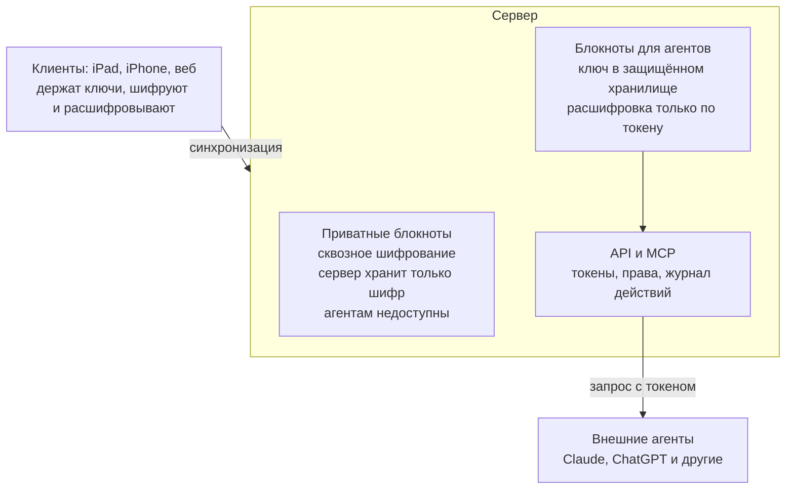

# 7. Шифрование и доступ агентов

Решения: D-04 (шифрование + API одновременно), D-09 (режим выбирается при создании блокнота).

## Два режима блокнотов

Пользователь выбирает режим при создании блокнота; сменить можно в любой момент — клиент перешифровывает данные.

- **Приватные** — как в Notesnook: ключ выводится из пароля пользователя и живёт только на его устройствах. Сервер хранит только шифр и ретранслирует зашифрованные изменения. Агентам недоступны.
- **Для агентов** — ключ блокнота хранится в защищённом хранилище ключей на сервере; расшифровка только по запросу с действительным токеном и правами на этот блокнот.

В интерфейсе честно предупреждаем, что во втором режиме сервер технически может прочитать заметки.

## Криптография (ПРЕДЛОЖЕНО, детали — этап 3)

- **libsodium** на всех платформах (swift-sodium на iOS, libsodium-wrappers в TS).
- **Argon2id** — вывод ключа из пароля.
- **XChaCha20-Poly1305** — шифрование содержимого.
- Отдельный ключ на блокнот, обёрнутый мастер-ключом пользователя (приватный режим) или ключом сервера (режим «для агентов»).
- Ключ сервера для режима «для агентов» хранится **отдельно от базы** (секрет окружения/файл), чтобы одного дампа БД было недостаточно для расшифровки (R-10).
- Совместимость Swift ↔ TypeScript проверяется общими тестовыми векторами (`packages/test-vectors`).

## Вход и восстановление доступа (D-34)

Вход — email + пароль; из пароля на устройстве выводятся ключ входа и ключ шифрования. При регистрации выдаётся ключ восстановления (R-02). Проверка, что ключ записан (ввод нескольких слов/групп ключа), — **необязательная**: на экране есть «Пропустить» с коротким предупреждением; на устройстве, где ключ выдан, его можно снова показать в настройках (он хранится только в защищённом хранилище этого устройства); на любом устройстве можно «Создать новый ключ восстановления» по паролю — старый ключ при этом перестаёт работать (`POST /v1/auth/recovery-key`). Пока ключ не подтверждён (`settings.recoveryKeyConfirmed` документа аккаунта, общий для устройств), в настройках висит ненавязчивое напоминание; в журнале безопасности видны смена пароля, использование и смена ключа (РЕШЕНО пользователем, 2026-10-25, по итогам первой сборки TestFlight). Точный формат ключей и шифротекста — контракт `docs/architecture/contracts/crypto.md`.

Если сеанс устройства завершён с другого устройства (сервер однозначно сообщил, что устройство отозвано; временная ошибка сети и истёкший токен так не трактуются), клиент **стирает все локальные данные** — базу, ключи, вложения и кэш картинок, включая неотправленные изменения — и сообщает: «Это устройство отключено от аккаунта с другого устройства. Данные на нём удалены. Войдите снова — заметки загрузятся с сервера». Перед отзывом предупреждает то устройство, с которого его запускают: «Завершить сеанс» в списке устройств, смена пароля, восстановление по ключу (РЕШЕНО пользователем 2026-10-27, D-53; заменяет правило от 2026-10-26, по которому данные хранились до следующего входа). На экране входа по-прежнему есть «Удалить данные с этого устройства».

**Выход из аккаунта (РЕШЕНО пользователем, 2026-10-26).** Если на устройстве есть неотправленное (изменения или блокноты, ещё не дошедшие до сервера), перед выходом показывается предупреждение: «На этом устройстве N неотправленных изменений. Они отправятся после входа в этот же аккаунт» — с выбором «Сначала отправить» (дождаться синхронизации) и «Выйти». Ключи неотправленных блокнотов при выходе **не стираются** (остаются в защищённом хранилище устройства) до их успешной отправки после входа в тот же аккаунт; при входе в другой аккаунт или «Удалить данные с этого устройства» они удаляются вместе с локальными данными.

## На будущее

Локальный MCP-мост — утилита на компьютере пользователя, которая держит ключ и даёт локальным агентам доступ даже к приватным блокнотам.

## Схема

## Защита данных на устройстве (iOS, аудит 2026-10-27, build 21)

- **Имена из содержимого заметки — не пути.** Идентификаторы вложений принимаются только в формате UUIDv7 (как `EntityID.isValid`), иначе файл не открывается и не создаётся; имя файла из блока `file` (для «Поделиться» и Quick Look) — только последний компонент без `/`, `\` и имён из одних точек.
- **«Удалить данные с устройства» и вход в другой аккаунт** стирают и расшифрованные вложения (файлы и их записи), и картинки в памяти; перед удалением данных сессия закрывается на сервере (`/auth/logout`).
- **Секреты в буфере обмена** (ключ восстановления, токен агента, ссылка с ключом `#k=`) — только на этом устройстве (без Universal Clipboard) и исчезают через 60 секунд.
- **Повторный показ ключа восстановления** в настройках — после Face ID / Touch ID / код-пароля (устройство без код-пароля не спрашивает); ключ скрыт, пока экран записывается или транслируется.
- **Большие изображения** декодируются вне главного потока и никогда целиком (уменьшение ImageIO прямо из файла); изображения больше 50 Мп отклоняются до декодирования.
- **Картинки из вставленной веб-страницы** скачиваются отдельным сеансом без cookies и кэша: только https, до 20 МБ, 15 с, не больше 3 перенаправлений, не больше 50 картинок за вставку; адреса этого устройства и его сети (loopback, частные, link-local, `.local`) запрещены — проверка после разрешения DNS и на каждом перенаправлении.
