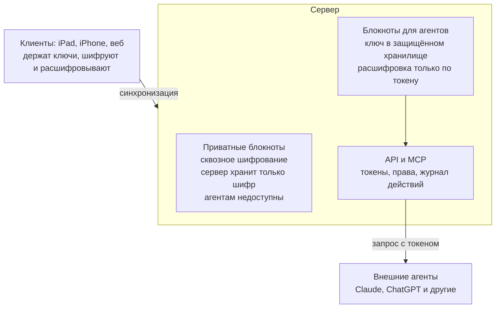

# 7. Шифрование и доступ агентов

Решения: D-04 (шифрование + API одновременно), D-09 (режим выбирается при создании блокнота).

## Два режима блокнотов

Пользователь выбирает режим при создании блокнота; сменить можно в любой момент — клиент перешифровывает данные.

- **Приватные** — как в Notesnook: ключ выводится из пароля пользователя и живёт только на его устройствах. Сервер хранит только шифр и ретранслирует зашифрованные изменения. Агентам недоступны.
- **Для агентов** — ключ блокнота хранится в защищённом хранилище ключей на сервере; расшифровка только по запросу с действительным токеном и правами на этот блокнот.

В интерфейсе честно предупреждаем, что во втором режиме сервер технически может прочитать заметки.

## Криптография (ПРЕДЛОЖЕНО, детали — этап 3)

- **libsodium** на всех платформах (swift-sodium на iOS, libsodium-wrappers в TS).
- **Argon2id** — вывод ключа из пароля.
- **XChaCha20-Poly1305** — шифрование содержимого.
- Отдельный ключ на блокнот, обёрнутый мастер-ключом пользователя (приватный режим) или ключом сервера (режим «для агентов»).
- Ключ сервера для режима «для агентов» хранится **отдельно от базы** (секрет окружения/файл), чтобы одного дампа БД было недостаточно для расшифровки (R-10).
- Совместимость Swift ↔ TypeScript проверяется общими тестовыми векторами (`packages/test-vectors`).

## Вход и восстановление доступа (D-34)

Вход — email + пароль; из пароля на устройстве выводятся ключ входа и ключ шифрования. При регистрации выдаётся ключ восстановления (R-02). Проверка, что ключ записан (ввод нескольких слов/групп ключа), — **необязательная**: на экране есть «Пропустить» с коротким предупреждением; на устройстве, где ключ выдан, его можно снова показать в настройках (он хранится только в защищённом хранилище этого устройства); на любом устройстве можно «Создать новый ключ восстановления» по паролю — старый ключ при этом перестаёт работать (`POST /v1/auth/recovery-key`). Пока ключ не подтверждён (`settings.recoveryKeyConfirmed` документа аккаунта, общий для устройств), в настройках висит ненавязчивое напоминание; в журнале безопасности видны смена пароля, использование и смена ключа (РЕШЕНО пользователем, 2026-10-25, по итогам первой сборки TestFlight). Точный формат ключей и шифротекста — контракт `docs/architecture/contracts/crypto.md`.

## На будущее

Локальный MCP-мост — утилита на компьютере пользователя, которая держит ключ и даёт локальным агентам доступ даже к приватным блокнотам.

## Схема

